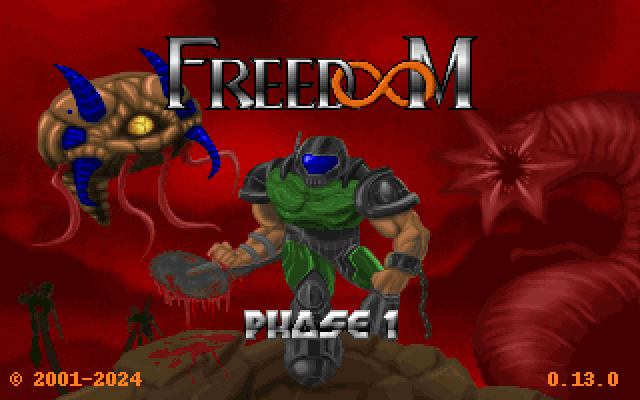
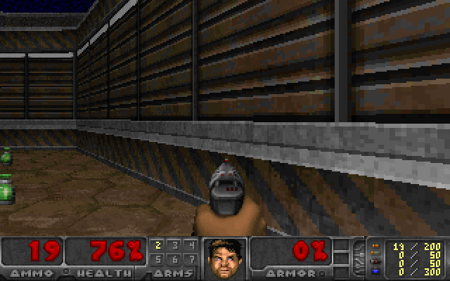
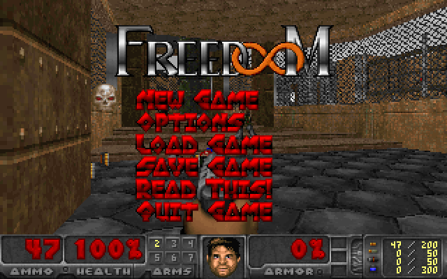

# Freedoom in WebAssembly

**DOOM — the most famous open source game there is — compressed, cross-compiled and
decompiled so it runs in a browser tab.** No plugins, no installers, no emulators,
no id Software assets: the engine is the GPL DOOM source (via
[doomgeneric](https://github.com/ozkl/doomgeneric)) compiled to WebAssembly, and the
game data is [Freedoom](https://freedoom.github.io) Phase 1, which is BSD licensed.



| in-game | menu |
|---|---|
|  |  |

---

## ▶ Play it now

**[cocre6369.github.io/webgamefree](https://cocre6369.github.io/webgamefree/)** — click it,
wait a few seconds for the 10 MiB of game data, press **▶ Play**. Nothing to install, no
plugin, no account; savegames live in your browser.

The site is the `web/` directory of this repository, published by
[`.github/workflows/pages.yml`](.github/workflows/pages.yml) — no build step on the
server, the engine and the game data are committed.

`node tools/play-link.mjs` prints the current links, including a CDN link pinned to the
latest commit that needs no repository settings at all:

```
GitHub Pages   https://cocre6369.github.io/webgamefree/
jsDelivr CDN   https://cdn.jsdelivr.net/gh/cocre6369/webgamefree@<commit>/web/index.html
```

## Run it locally

```bash
node serve.mjs          # then open http://localhost:8000

# or with Python, if you prefer:
python3 -m http.server --directory web 8000
```

That is the whole setup — no build step, no toolchain, nothing to download: the
10 MiB of game data and the 183 KiB engine are already in `web/`.  The local server
adds `application/wasm` and COOP/COEP headers, which is what unlocks the
AudioWorklet mixer; on GitHub Pages the game runs the same, using the
ScriptProcessor mixer instead.

* **Arrow keys** walk and turn, **Ctrl** fires, **Space** opens doors, **Shift** runs
* **Esc** menu, **Tab** automap, **1**–**7** weapons, **F5/F9** quicksave/quickload
* Click the screen for mouse turning, **F** fullscreen, **M**/**S** toggle music/sound
* Touch devices get on-screen controls automatically
* Savegames and settings live in `localStorage` — they survive a reload

## What "compressed and decompiled" means here

Three separate things happened to get DOOM into a browser tab:

**1. The game data is compressed.** Freedoom Phase 1 is 27.5 MiB of WAD. It ships
here as a 9.8 MiB gzip stream, and the browser decompresses it with
`DecompressionStream` (162 ms) straight into the engine's virtual filesystem —
the uncompressed WAD is never written to disk.

**2. The engine is cross-compiled, not emulated.** ~68,000 lines of C are compiled
to a 476 KiB WebAssembly module (183 KiB over the wire) using Zig's C→wasm32
cross compiler and wasi-libc — no Emscripten, no DOS emulator, no x86 in a
browser. WASM runs at near-native speed: measured here at **0.72 ms per game tic,
which is 39× faster than the 28.6 ms the 35 Hz simulation is allowed**.

**3. The result is decompiled back into something readable.** `tools/decompile.mjs`
reverses the compiled module into the WebAssembly text format and documents its
entire interface — every import the engine needs from the page, every export the
page calls — in [`docs/decompiled/api.md`](docs/decompiled/api.md), with the
exported functions as readable WAT in
[`docs/decompiled/exports.wat`](docs/decompiled/exports.wat):

```bash
node tools/decompile.mjs          # API tables + exported functions as WAT
node tools/decompile.mjs --full   # + the whole module as .wat and as C (wasm2c)
```

The round trip closes: this project's `void dg_tick(void)` becomes a WebAssembly
export, and decompiling the built module gives back
`void w2c_doom_dg_tick(w2c_doom*)` — a C function again, alongside the 342
other functions that make up the engine.

| artefact | size |
|---|---|
| `web/doom.wasm` | 476 KiB (183 KiB gzipped) |
| `web/assets/freedoom1.wad.gz` | 9.8 MiB (27.5 MiB decompressed, 2.80:1) |
| **first visit, total** | **≈ 10.0 MiB** — then cached by a service worker and playable offline |

## How it works

```
┌──────────────────────────── browser tab ─────────────────────────────┐
│  index.html + style.css                    canvas 640x400            │
│                                                                      │
│  main.js      load, boot, 35 Hz frame loop, saves, input, UI         │
│    ├─ doom.js     drives the wasm module: dg_create / dg_tick / …    │
│    │   ├─ wasi.js   WASI preview1 + virtual filesystem in JS         │
│    │   └─ music.js  MIDI/MUS → Web Audio synth                       │
│    ├─ renderer.js   framebuffer → WebGL2 texture → screen            │
│    ├─ audio.js      AudioWorklet mixer (ScriptProcessor fallback)    │
│    ├─ input.js      keyboard, mouse-turn, touch → DOOM key codes     │
│    └─ savedata.js   savegames + config → localStorage                │
│                                                                      │
│  doom.wasm    the DOOM engine (C, wasm32-wasi)                       │
│    ├─ doomgeneric_web.c   platform layer: video, clock, input        │
│    ├─ i_web_sound.c       16-channel software mixer + music bridge   │
│    └─ …                   the original 1993-96 id source, unchanged  │
└──────────────────────────────────────────────────────────────────────┘
```

The C platform layer is where the interesting problems live, because a browser
is a strange device to be a DOOM port:

* **Time.** DOOM's main loop blocks: it waits for the next tic, and sleeps when
  it is ahead of schedule. A browser tab cannot block, so the tick loop is cut
  open — the engine runs exactly one tic per `dg_tick()` call, JavaScript owns
  the clock, and `DG_SleepMs()` *lies*: instead of sleeping it moves a virtual
  clock forward so the engine's wait loops observe time passing and return
  immediately. The page then drives the engine at exactly 35 tics per second,
  scheduled against `requestAnimationFrame`, so the game runs at the correct
  speed on a 60 Hz laptop, a 144 Hz monitor or a throttled background tab.

* **Video.** The engine writes 640×400 of `0xAABBGGRR` words straight into its
  own linear memory. The renderer uploads that memory as an RGBA texture and
  draws it 1:1 with `gl_VertexID`-generated geometry — no framebuffer copy, no
  colour conversion, no per-pixel JavaScript.

* **Sound.** The engine's sound module is replaced by a 16-channel software
  mixer in C (DMX 8-bit samples → signed 16-bit, resampled and panned), which
  JavaScript pulls on demand from the audio callback. Cross-origin isolation lets
  the mixer feed an `AudioWorklet` through a `SharedArrayBuffer` ring buffer;
  without those headers it falls back to a `ScriptProcessorNode`, and a watchdog
  switches at runtime if a worklet ever stops consuming.

* **Music.** Freedoom ships MIDI, the original IWADs ship MUS, and a browser has
  no OPL2 chip. So `music.js` parses both formats (tempo maps and all) and plays
  them with a small Web Audio synth — bass, brass, organs and noise drums, with
  a 500 ms lookahead so timing does not depend on frame rate.

* **Files.** The engine opens the IWAD, writes `default.cfg` and saves games to
  `.dsg` files, so there is a full WASI `preview1` implementation in
  `web/js/wasi.js` over a virtual filesystem that lives in JavaScript memory.
  That is what makes savegames and settings work — and what makes them easy to
  mirror into `localStorage`.

More detail, including all the dead ends, is in
[docs/ARCHITECTURE.md](docs/ARCHITECTURE.md).

## Build it yourself

```bash
./build.sh              # fetches the toolchain + engine sources, builds web/doom.wasm
./build.sh --clean      # from scratch
DOOM_RESX=320 DOOM_RESY=200 ./build.sh    # the original low-res rendering mode
```

`build.sh` downloads Zig 0.14.1 (which ships a full C cross compiler and
wasi-libc) and the doomgeneric sources into `.tools/` and `.build/` — both
git-ignored, so the repository stays at ~10 MiB — then compiles 82 translation
units, links, and runs `wasm-opt -O3` if you have run `npm install`.

## Test it

```bash
npm test        # or: node tools/smoke.mjs --play && node tools/browser-sim.mjs
```

Three harnesses, because "it compiles" is not "it works":

| tool | what it proves |
|---|---|
| `tools/smoke.mjs --play` | headless: boots the engine in Node, plays the game (Escape → N → episode → skill), walks, turns, shoots, mixes audio, and writes PNG screenshots straight from the engine's framebuffer |
| `tools/browser-sim.mjs` | loads the actual web app against a mock DOM/WebGL2/AudioContext, clicks Play, navigates the menus with synthetic keyboard/touch/mouse events, checks the renderer, audio, toggles and the save store — 28 assertions |
| `tools/audio-worklet-sim.mjs` | runs the `SharedArrayBuffer` audio path with a simulated audio thread: proves samples flow, the ring never runs dry, nothing clips, and the fallback watchdog works |

## Repository layout

```
build.sh                 compile the engine to web/doom.wasm
serve.mjs                static server (application/wasm, COOP/COEP headers)
src/doomgeneric_web.c    browser platform layer: video, clock, input, exports
src/i_web_sound.c        software mixer + music bridge
src/compat/              stub headers for the web build
web/index.html           the page
web/js/                  wasi.js doom.js renderer.js audio.js audio-worklet.js
                         music.js input.js savedata.js main.js
web/doom.wasm            the built engine
web/assets/              Freedoom IWAD (gzipped) + its licence and credits
.github/workflows/       pages.yml - publishes web/ to GitHub Pages
tools/                   smoke test, browser simulation, audio simulation,
                         decompiler, WAD fetcher, play-link
docs/decompiled/         api.md, exports.wat - what is inside doom.wasm
docs/screenshot-*.png    screenshots, written by the smoke test
```

## Licensing

* **Engine** — DOOM source © 1993–1996 id Software, © 2005–2014 Simon Howard, and
  the [doomgeneric](https://github.com/ozkl/doomgeneric) port by Ozkan Sezer et al.
  **GPL-2.0-or-later** (full text in [LICENSE](LICENSE)). Everything in this
  repository that links against it — including `src/` and the `web/` glue — is
  distributed under the same licence. Corresponding sources: the engine sources
  are fetched and compiled by `build.sh` from the upstream repository; the
  browser-side sources are all in this repository.
* **Game data** — [Freedoom](https://freedoom.github.io) Phase 1,
  © 2001–2024 the Freedoom contributors, **BSD-3-Clause**
  ([web/assets/FREEDOOM-COPYING.txt](web/assets/FREEDOOM-COPYING.txt),
  credits in [FREDOOM-CREDITS.txt](web/assets/FREEDOOM-CREDITS.txt)).
  Freedoom is an independent free game; **no id Software assets are included**.
* **Toolchain and libraries** — Zig (MIT), wasi-libc (Apache-2.0/MIT),
  Binaryen (Apache-2.0), WABT (Apache-2.0). See [THIRD-PARTY.md](THIRD-PARTY.md).

DOOM is a trademark of id Software LLC. This is an unofficial, non-commercial
fan project, not affiliated with or endorsed by id Software, Bethesda or the
Freedoom project.
